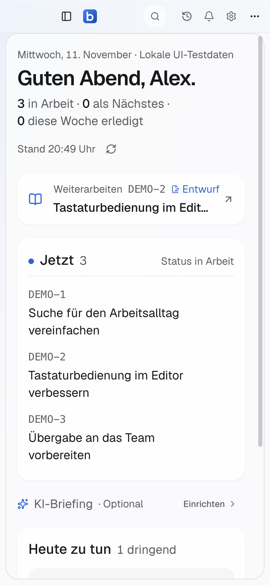

# Kritische UX-Prüfung · 11. November 2026

## Ergebnis und Geltungsbereich

**95 von 100 Punkten für die geprüften Kernabläufe nach Nachbesserung.** Die erste Bewertung des überarbeiteten Zwischenstands lag bei 90 Punkten und enthielt einen Freigabeblocker bei der Tastaturbedienung. Dieser wurde in der Anwendung reproduziert, behoben und erneut geprüft.

Die Zahl ist eine gewichtete technische Reviewbewertung, keine gemessene Nutzerzufriedenheit. Getestet wurde die echte React-Anwendung mit der lokalen Jira-/Tauri-Fixture im eigenen Browser-Tab. Die Perspektiven unten sind simulierte Personas; es fanden keine Interviews oder Tests mit echten Menschen statt. Der Prüfer war unabhängig von der Shell-, Dashboard- und Persistenzimplementierung, hat aber die separat benannten Release-/Materialkorrekturen selbst implementiert. Für diese Teile handelt es sich um Selbstprüfung.

Der Wert gilt für Orientierung, Wiederaufnahme, Ticketsuche, lokale Zustände und die betrachteten Darstellungen. Er bescheinigt weder 95 Prozent Qualität jeder bestehenden Funktion noch eine empirisch geprüfte native Darstellung auf allen Betriebssystemen. Die vollständigen automatisierten Tests und der veröffentlichte Release sind zusätzliche Freigabebedingungen; ihre Ergebnisse werden separat ergänzt.

## Maßstab

Jedes Kriterium erhält die angegebenen Punkte anteilig anhand von beobachtetem Verhalten und überprüfbarem Code. Volle Punkte bedeuten: Die in der Spalte genannten Prüfbedingungen sind im betrachteten Umfang erfüllt. Abzüge stehen für konkrete Schwächen oder fehlende empirische Absicherung; sie werden nicht durch zusätzliche Funktionen kompensiert.

| Kriterium | Max. | Zuerst | Nachprüfung | Prüfbedingungen und Begründung |
| --- | ---: | ---: | ---: | --- |
| Orientierung | 20 | 18 | 19 | Arbeitsnavigation, nächster Schritt, eindeutige Filterbegriffe. Konkurrierende Filterbezeichnungen wurden getrennt. Einige generische Beschriftungen für assistive Technik sind weiterhin englisch. |
| Alltagsabläufe | 20 | 19 | 19 | Suche → Ticket → Kontextwechsel → Wiederaufnahme ohne Sackgasse. Lange Titel werden in kompakten Übersichten gekürzt; der vollständige Titel steht im Ticket. |
| Persistenz und Schutz | 20 | 20 | 20 | Tatsächliches Wiederherstellen von Suchtext, Navigation und Entwurf; bestätigtes Konto als Schlüssel; validierte Hydration, defektes JSON und gesperrter Speicher durch gezielte Tests abgedeckt. |
| Tastatur und Anpassung | 15 | 11 | 14 | Unsichtbare Navigation darf keinen Fokus erhalten; Fokusrettung beim Einklappen; 390/760/1440 px, helle/dunkle Darstellung und große Schrift. Der reproduzierte Fokusfehler wurde behoben. Kein vollständiger Screenreader-Audit. |
| Glass, Hierarchie und Ausrichtung | 15 | 14 | 14 | Ruhige Flächen, konsistente Ausrichtung, lesbarer Inhalt vor Materialwirkung. Visuell im Browser geprüft; native Mac-/Windows-Materialwirkung nicht mit derselben Prüftiefe gesehen. |
| Reaktionsverhalten und technische Auslieferbarkeit | 10 | 8 | 9 | Navigation und Suche reagieren im lokalen Ablauf direkt; native Windows-Transparenz wird erst nach erfolgreicher Materialaktivierung freigegeben. Kein belastbarer Vergleich mit realen Jira-Latenzen oder GPU-Profiling. Release bleibt eine gesonderte Pflichtprüfung. |
| **Gesamt** | **100** | **90** | **95** | **Schwelle für den geprüften Umfang erreicht.** |

95–100: für den geprüften Umfang freigabefähig. 90–94: gezielte Nachbesserungen erforderlich. 80–89: deutliche Lücken. Unter 80: grundlegende Überarbeitung erforderlich. Ein Befund mit Datenverlust, Kontovermischung oder blockierter zentraler Navigation verhindert die Freigabe unabhängig von der Summe. Ein fehlgeschlagener Build oder unvollständiger Release verhindert die Veröffentlichung ebenfalls unabhängig von der UX-Punktzahl.

## Befunde und Nachprüfung

| Befund | Schwere | Konkreter Nachweis | Korrektur und Ergebnis |
| --- | --- | --- | --- |
| Eingeklappte Desktop-Seitenleiste bleibt in der Tab-Reihenfolge | Freigabeblocker | Bei 1440 px Seitenleiste einklappen, Menü schließen und weiter mit Tab: Fokus lag auf „Heute“ bei x = −248 bis −9, vollständig außerhalb des Fensters. Nach Neuladen blieb die Navigation eingeklappt und der Fehler wirksam. | Offcanvas-Container erhält `inert` und `aria-hidden`. Erneut geprüft: Container ist inert; beim Einklappen mit ⌘B aus einem fokussierten Sidebar-Link wandert der Fokus zum sichtbaren Sidebar-Trigger. |
| Zwei benachbarte Filteraktionen wirken doppelt | Mittel | Tabelle zeigte „Weitere Filter“ und zusätzlich „Filter“, ohne die unterschiedliche Aufgabe am Auslöser kenntlich zu machen. | „Schnellfilter“ für Kurzregeln und „Eigenschaften“ für Feldfilter. Beide Bezeichnungen in der laufenden Ticketansicht erneut geprüft. |
| Windows-Material bleibt durch den Hintergrund verdeckt | Mittel | Windows-Konfiguration enthielt Mica, aber die Freigabe der transparenten CSS-Flächen war nur für Mac vorgesehen. Tauri selbst verwirft den Rückgabewert seiner Materialaktivierung. | Neues natives Kommando ruft `window_vibrancy::apply_mica` direkt auf und meldet Erfolg als validiertes Boolean. Erst dann aktiviert der Hook transparente native Flächen. Windows 10 und Fehler behalten den deckenden Fallback. Code/Abhängigkeit und Mac-Kompilation geprüft; Windows-GUI-Nachweis steht außerhalb dieses Browserreviews. |
| Ticketschlüssel bricht bei sehr großer Schrift am Bindestrich um | Klein | 390 px, Hell, „Sehr groß“, Wiederaufnahme mit Entwurfskennzeichen: DEMO-2 stand auf zwei Zeilen. | Schlüssel erhält `shrink-0 whitespace-nowrap`. In erneuter Aufnahme ist DEMO-2 einzeilig. |

## Szenario-Walkthroughs

| Perspektive | Durchgeführter Ablauf | Beobachtung |
| --- | --- | --- |
| Neuer Nutzer | Startseite → sichtbare aktuelle Arbeit → Ticket; Navigation und Suchzugang lesen | Arbeitsliste und „Weiterarbeiten“ sind klar erkennbare Einstiege. Tageshinweise stehen als ergänzender Block statt mehrerer gleichrangiger Hauptmodule. |
| Tastatur-/Vielnutzer | ⌘K → DEMO-2 eingeben → Enter; erneut ⌘K → Arbeitsplatz → Enter | Richtige Route und Ticket geöffnet. Palette erlaubt den Wechsel ohne Umweg über Seitenleisten. Der oben dokumentierte Offcanvas-Fokusfehler wurde dabei gefunden und nachgeprüft. |
| Unterbrochener Bearbeiter | In DEMO-2 einen Kommentarentwurf schreiben → Arbeitsplatz öffnen → Fixture vollständig neu laden → DEMO-2 öffnen | Arbeitsplatz zeigt Entwurf und Lesestelle. Nach vollständigem Neuladen steht exakt „Kritische Prüfung: Entwurf nach Unterbrechung behalten.“ wieder im Kommentarfeld. Es wurde kein Kommentar abgesendet. |
| Nutzer mit eigener Arbeitsanordnung | In Ticketsuche „Tastatur“ eingeben, Sidebar und Filtergruppe einklappen → vollständiger Fixture-Neustart | Suchfeld enthält wieder „Tastatur“. Gespeicherter Zustand enthält `sidebarOpen: false`, `sections.Filter: false` und den Suchtext unter dem bestätigten Konto. |
| Schmaler Arbeitsbereich | Startseite, Ticketdetail und Palette bei 390 px; Arbeitsplatz und Tabelle bei 760 px; Bereichstabelle bei 1440 px | Kein horizontaler Dokumentüberlauf in den betrachteten Zuständen. Die breite Tabelle scrollt innerhalb ihres eigenen Rahmens. Die Palette bleibt innerhalb des schmalen Fensters bedienbar. |
| Vergrößerte Schrift | Darstellung → „Sehr groß“ → Startseite bei 390 × 844 px, Hell | Schriftwahl bleibt nach Neuladen erhalten. Dokumentüberlauf: false; Hauptinhalt `clientWidth = scrollWidth = 361`. Listenüberschriften umbrechen lesbar. |

Die Browser-Walkthroughs nutzten `/`, `/tickets`, `/arbeitsplatz`, `/bereiche/DEMO`, `/issue/DEMO-2` und `/settings/darstellung`, jeweils über `/tests/browser/fixture.html?route=…`, damit keine realen Jira-Schreibzugriffe stattfinden.

## Gezielte technische Prüfung

- Sieben Persistenztests in `src/hooks/use-interface-state.test.ts` erfolgreich: Wiederherstellung, Kontotrennung, kaputtes JSON, Migration ungültiger Daten, gesperrter/voller Speicher, identische Schreibwerte sowie gültige/ungültige Ansichten.
- `cargo check --manifest-path src-tauri/Cargo.toml --offline` erfolgreich nach dem neuen nativen Kommando. Eine bereits vorhandene Warnung betrifft die unbenutzte Outlook-Funktion `decode_response`.
- `actionlint .github/workflows/release.yml` und `git diff --check` erfolgreich für die Release-/Materialänderungen.
- Der frühere Release-Lauf 43041762718 scheiterte ausschließlich beim Linux-Paketdownload an DNS-Auflösung für `azure.archive.ubuntu.com`. Beide Mac-Builds und Windows inklusive Prozessstart waren erfolgreich. Der Workflow verwendet jetzt den öffentlichen Ubuntu-Mirror, begrenzte Netzwerk-Retries sowie Zeitlimits.

## Grenzen und verbleibende Nachweise

Keine Prüfung mit echten Jira-Konten, projektspezifischen Berechtigungen oder realistischer Netzwerklatenz in diesem Review. Keine Beobachtung echter Menschen. Kein vollständiger Screenreader-, GPU-, Linux-Desktop- oder nativer Windows-11-/Windows-10-Test. Die neue Materialaktivierung ist ein geprüfter sicherer Kontrollpfad, aber kein Ersatz für die visuelle Prüfung auf diesen Geräten.

Während laufender Quellcodeänderungen trat in einem bereits geöffneten Vite-Tab vorübergehend ein Hook-Reihenfolgefehler auf; ein frischer Fixture-Start stellte den vollständigen Ablauf wieder her. Dieser HMR-Zwischenstand wird nicht als belegter Produktionsdefekt gewertet. Die vollständigen Tests müssen auf einem stabilen finalen Produktionsbuild laufen.

Build, vollständige Unit-/Browserprüfung sowie Release-Version, Workflow-Ergebnis, Installer, Signaturen und Updater-Manifest werden nach Abschluss vom Hauptagenten ergänzt. Bis diese Nachweise vorliegen, bedeutet die UX-Bewertung keine abgeschlossene Releasefreigabe.

## Ergänzende Nachweise des Hauptagenten

- Produktionsbuild, finaler Typecheck und `cargo check --locked` erfolgreich. Der Typecheck enthält nur zwei bereits vorhandene Effect-Sprachdiensthinweise in der Änderungshistorie.
- Alle 996 Unit-Tests in 111 Dateien erfolgreich. Die Transporttests laden ihre Module vor Beginn der simulierten Zeit; Netzwerkbudgets und Assertions bleiben unverändert. Dadurch zählen langsame Modulimporte nicht als simulierte Netzwerkzeit und hinterlassen keine abgebrochenen Requests für Folgetests.
- Gegen den endgültigen Quellstand: 34 Header-/Persistenz-Browserfälle bestanden, zwei reine Desktopfälle in der schmalen Variante absichtlich ausgelassen. Darunter Fokusrettung, Wiederherstellung, Dichte und Kontotrennung.
- Zusätzlich reproduziert und behoben: Bei simulierter Windows-Fensterleiste im 390-px-Fenster überdeckte „Minimieren“ das Aktionsmenü um 8 px. Angepasste mobile Fensterbuttons und Platzreservierung beseitigen die Überdeckung. Beide zusätzlichen Browserfälle bestehen. Die drei Fensterbuttons haben jetzt Tooltips; die Benachrichtigungsglocke eine 32-px-Klickfläche.
- Entwicklungs-CI auf `3ac73d0` erfolgreich. Kein offener Pull Request bei Beginn der Integration und bei der erneuten Prüfung.

## Abschließende Browserprüfung vor Veröffentlichung

Der vollständige Produktions-QA-Lauf umfasste 910 Fälle: 893 bestanden, 15 bewusst ausgelassen, zwei zunächst fehlgeschlagen. Der Sortierfall maß eine nominelle 32-px-Fläche als 31,999984741210938 px; die Prüfung wartet jetzt auf die Fläche und rundet nur auf Hundertstelpixel.

Die Kontoprüfung zeigte dagegen einen tatsächlichen Anwendungsfehler: Neu gemountete Beobachter starteten die fehlgeschlagene Identitätsabfrage erneut, wodurch der Retry dauerhaft deaktiviert blieb. `retryOnMount: false` verhindert diese Wiederholungsschleife; explizite Wiederholung, Fensterfokus-/Online-Aktualisierung und der Reset bei An-/Abmeldung bleiben möglich. Der Test entfernt den simulierten Fehler erst beim Retry-Klick und bestätigt exakt einen ersten Abruf und einen zweiten nach dem Klick.

Nach der Korrektur bestanden alle 996 Unit-Tests erneut sowie Typecheck und Produktionsbuild. Der erneute Produktions-QA-Lauf über Sitzungen, Kontotrennung, Tabs, Projektpräferenzen, Navigation, Header, Persistenz, Ticketwiederherstellung und Arbeitsplatz endete mit 152 bestandenen und zwei absichtlich ausgelassenen Fällen. Der gezielte Kontofehler-Test mit Abrufbudget bestand zusätzlich in beiden Darstellungen.

Zusammengeführt nach Datei, vollständigem Testtitel und Darstellungsprojekt ergeben Gesamt- und Nachlauf **912 eindeutige Browserfälle: 897 bestanden, 15 bewusst ausgelassen, keine verbleibenden unerwarteten Ergebnisse**. Das ist kein behaupteter einzelner fehlerfreier Komplettlauf; nach der letzten funktionalen Korrektur wurden die betroffenen 154 Fälle und die vollständigen Unit-Tests erneut ausgeführt.

Design MCP: Persönliches Profil und gespeicherte Desktopreferenzen wurden vor der Gestaltung geladen, anschließend `review_design` eingesetzt. Der frische Bookmark-Abgleich lieferte keine neuen Dateien. Ein zusätzlicher frischer X-Likes-Import war ohne den nicht konfigurierten X-Handle nicht möglich; die optionale Nachfrage blieb bis zu dieser Prüfung unbeantwortet.

## Veröffentlichung und native Nachprüfung

Release [v0.12.0](https://github.com/Leon-Achteresch/betterjira/releases/tag/v0.12.0) wurde am 11. November 2026 um 20:35 UTC veröffentlicht und als neuester Release gesetzt. Der Tag zeigt auf `ef11fea478177efb3e0c725cd262ebd5bfb7e15a`; sämtlicher Entwicklungscode einschließlich der zuvor nur auf Main vorhandenen Kommentar-/Anhangsfunktionen ist enthalten. Es gab keine offenen Pull Requests.

Alle vier Paketjobs des [Release-Laufs](https://github.com/Leon-Achteresch/betterjira/actions/runs/43094657243) haben sämtliche Schritte einschließlich „Complete job“ erfolgreich beendet; auch der native Windows-Prozessstart ist erfolgreich. GitHub hält ihre Jobzustände dennoch auf „in_progress“ und den letzten Manifestjob ohne Runner auf „queued“. Normaler und erzwungener Abbruch werden mit HTTP 409 abgelehnt. Die verbleibenden Release-Schritte wurden deshalb mit demselben Repository-Skript lokal durchgeführt. Dieser dokumentierte Zustand ist ausdrücklich kein behaupteter grüner Gesamtabschluss des GitHub-Workflows; seine weitere Überwachung wird separat fortgeführt.

Nach Veröffentlichung wurden alle 17 Assets heruntergeladen und ihre Größen mit den Release-Metadaten abgeglichen. Die sieben tatsächlichen Update-Dateien für Mac ARM/Intel, Linux AppImage/DEB/RPM und Windows MSI/NSIS wurden mit `minisign-verify` gegen den öffentlichen Schlüssel der App kryptografisch verifiziert. Alle Signaturen sind gültig und stimmen mit `latest.json` überein. Die beiden DMG-Installer sind vorhanden. Der öffentliche Endpunkt `releases/latest/download/latest.json` liefert Version 0.12.0 und alle elf Plattform-/Alias-Einträge.

Das ausgelieferte Mac-ARM-Archiv wurde zusätzlich entpackt: Info.plist-Version 0.12.0, Mach-O arm64 und `codesign --verify --deep --strict` erfolgreich. Genau diese App wurde auf macOS 27.0.1 gestartet und mit dem vorhandenen Jira-Konto nur lesend durch Tagesansicht, echte Ticketliste, Arbeitsplatz und zurück zur Tagesansicht bedient. Das native Fenster, die Glasflächen und die Inhalte wurden visuell geprüft; anschließend wurde die Testinstanz ordnungsgemäß beendet. Private Screenshots bleiben außerhalb des Repositorys. Das erweitert den Nachweis um einen tatsächlichen nativen Mac-Ablauf, ersetzt aber weiterhin keinen vollständigen produktiven Jira-/OAuth-Test oder nativen Windows-UX-Audit.

Ein zweiter unabhängiger Prüfer bestätigte den zuletzt behobenen Kontofehler direkt in der Anwendung: stabil genau ein fehlgeschlagener Kontoabruf, aktiver Retry, keine Ticketdaten/Tabs; nach bewusstem Retry insgesamt zwei Kontoabrufe und genau ein Ticketabruf. Kein neuer Blocker; 95/100 für den dokumentierten Kernumfang bleiben vertretbar.

## Endzustand der Hintergrundüberwachung

Die Beobachtung ist abgeschlossen. Der GitHub-Lauf erreichte am 11. November 2026 um 21:01:02 UTC den Endzustand `completed / failure`; GitHub meldet „Internal server error.“ (Korrelations-ID `84bc1ff0-f919-47a2-9805-d0a6e57978c5`). Test, Versionsjob und alle vier Paketjobs sind erfolgreich abgeschlossen. Der Manifestjob erhielt keinen Runner; sein einzelner Datensatz bleibt trotz beendetem Gesamtlauf auf `queued`.

Die abschließende erneute Prüfung um 21:02:57 UTC bestätigt: v0.12.0 bleibt veröffentlicht, neuester Release und kein Entwurf. Tag und Zielcommit stimmen mit ef11fea überein; alle 17 erwarteten Dateien samt Hashes, sieben kryptografische Update-Signaturen und elf Manifest-Einträge sind gültig. Der frühere lokale Abschluss ist unverändert intakt. Ein erneuter Paketbau oder weiterer Release ist nicht erforderlich. Die maschinenlesbaren Nachweise stehen in `release-verification-0.12.0.json`.
